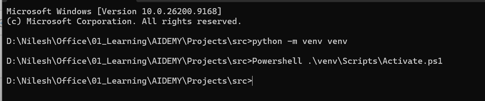
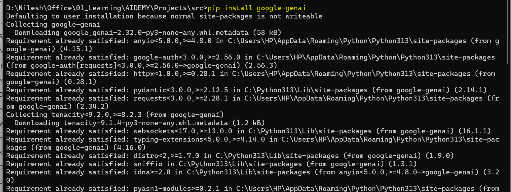
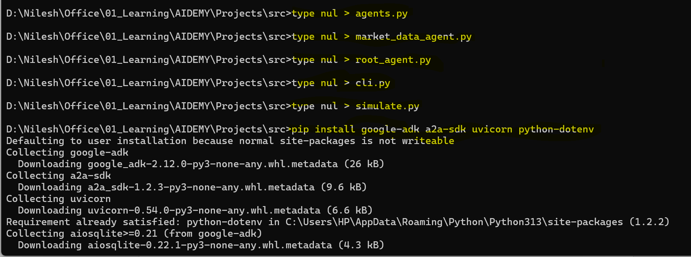
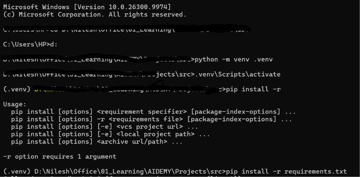

# Chapter 3: Project Setup & ADK Dependencies

> **Navigation:** [← Previous: Chapter 2: Create a Python Virtual Environment](./02-virtual-environment.md) | [Table of Contents](../README.md) | [Next: Chapter 4: Create Your First ADK Agent →](./04-create-first-agent.md)

| Metadata | Details |
| :--- | :--- |
| **Section** | Section 1 — Environment & Project Setup |
| **Estimated Time** | 15 minutes |
| **Tech Stack** | `google-adk`, `a2a-sdk`, `uvicorn`, `python-dotenv` |

---

## Summary

Install this project's dependencies, configure your `.env` file, establish the repository directory layout, and verify the core ADK imports every agent requires.

## Learning Goals

- Set up a Python environment for the **Google Agent Development Kit (ADK)** and the **Agent-to-Agent (A2A)** protocol.
- Distinguish between imports from `google.adk` versus the underlying `google.genai` SDK.

---

## Acceptance Criteria

- [ ] Virtual environment has `google-adk`, `a2a-sdk`, `uvicorn`, and `python-dotenv` installed.
- [ ] `.env` file exists in the project root with `GOOGLE_API_KEY=your_key_here`.
- [ ] `src/agents.py` imports `asyncio`, `Agent`, `InMemoryRunner`, and `types` without errors.

---

## Project Directory Structure

This is a multi-file, multi-process project. By the end of the tutorial, your repository will follow this structure:

```text
personal-finance-advisor/
├── README.md                  # Documentation index & architecture overview
├── requirements.txt           # Pinned Python dependencies
├── .env                       # Local environment variables (git-ignored)
├── docs/                      # Step-by-step tutorial chapters
│   └── assets/                # Reference setup screenshots
└── src/
    ├── agents.py              # In-process domain agents (Budgeting & Investment)
    ├── market_data_agent.py   # Standalone A2A server for stock prices
    ├── root_agent.py          # Coordinating Root Agent + savings goal tool
    ├── cli.py                 # Interactive CLI chat loop
    └── simulate.py            # Automated end-to-end smoke test script
```

---

## Step-by-Step Guide

### 1. Install Dependencies & Freeze Requirements

With your virtual environment activated, install the required packages and save `requirements.txt`:

```bash
pip install google-adk a2a-sdk uvicorn python-dotenv
pip freeze > requirements.txt
```

### 2. Configure Environment Variables

Create a `.env` file in your project root and add your Gemini API key:

```env
GOOGLE_API_KEY=your_google_api_key_here
```

### 3. Initialize `src/agents.py`

Create the `src/` folder and add `src/agents.py` with the foundational imports:

```python
# src/agents.py
import asyncio
import os
from dotenv import load_dotenv

from google.adk.agents import Agent
from google.adk.runners import InMemoryRunner
from google.genai import types

load_dotenv()
```

### Setup Reference Screenshots

The setup screenshots extracted from the project setup guide (`AIFIAgent-SetUp.docx`) are archived in [`docs/assets/`](./assets/):

**Setup Step 1**



**Setup Step 2**



**Setup Step 3**



**Setup Step 4**



**Package Log:**
[Package Installation Log](./assets/installation.log)

---

## Beginner Tip & Notes

> **Tip:** `Agent` is the core ADK building block used for every agent in this project. `InMemoryRunner` executes an agent against a conversation and maintains session state in memory—ideal for a CLI demo, though production deployments should use a persistent session store.

- **Next Step:** Chapter 4 builds your first minimal ADK agent using these imports.

---

> **Navigation:** [← Previous: Chapter 2: Create a Python Virtual Environment](./02-virtual-environment.md) | [Table of Contents](../README.md) | [Next: Chapter 4: Create Your First ADK Agent →](./04-create-first-agent.md)
