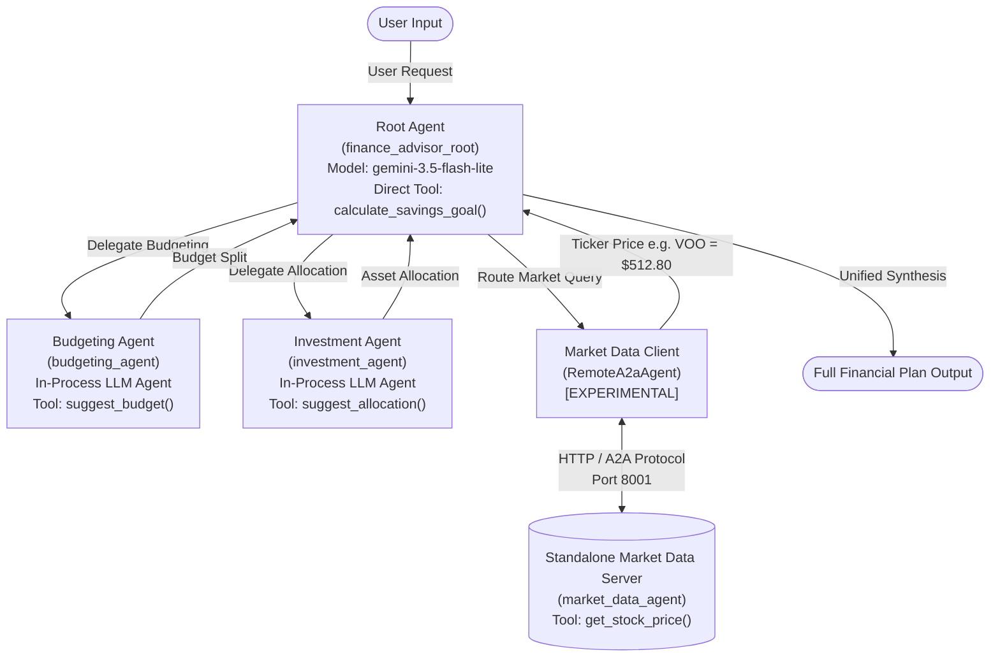

# Financial Advisor Multi-Agent System Architecture

**System Architecture & Agent-to-Agent (A2A) Protocol Workflow**

---

## 1. Overview

The **Personal Finance Advisor** is a multi-agent AI application built on **Google's Agent Development Kit (ADK)** and the **Agent-to-Agent (A2A)** protocol. It uses a hierarchical coordinator-specialist architecture to decompose complex, multi-domain financial queries—spanning monthly budgeting, portfolio asset allocation, savings timelines, and real-time market data—and synthesize the results into a unified **Full Financial Plan**.

---

## 2. High-Level Architecture Diagram



---

## 3. Architecture Component Breakdown

### 3.1 User Request (Client Entry Point)

- **Interfaces:** Interactive CLI (`src/cli.py`) or single-turn end-to-end simulation script (`src/simulate.py`).
- **Input:** Natural-language financial prompts that may span multiple domains in a single turn (e.g., asking for a monthly budget, an investment strategy, a savings timeline, and current stock prices such as `VOO`).

### 3.2 Root Agent (`finance_advisor_root`)

- **Role:** Central orchestrator and primary entry point for incoming user requests.
- **Model:** Powered by `gemini-3.5-flash-lite`.
- **Direct Tools:** `calculate_savings_goal()` — handles lightweight timeline calculations directly without delegating to a sub-agent.
- **Responsibilities:**
  - Interprets multi-dimensional user prompts.
  - Routes domain-specific sub-tasks to the appropriate specialist sub-agents.
  - Aggregates specialist outputs into a cohesive, user-friendly **Full Financial Plan**.

### 3.3 Specialist Sub-Agents

| Agent Name | Identifier | Execution Mode | Model / Protocol | Attached Tool(s) | Core Capability |
| :--- | :--- | :--- | :--- | :--- | :--- |
| **Budgeting Agent** | `budgeting_agent` | In-Process LLM Agent | `gemini-3.5-flash-lite` | `suggest_budget()` | Analyzes monthly income and calculates a 50/30/20 budget breakdown (Needs, Wants, Savings). |
| **Investment Agent** | `investment_agent` | In-Process LLM Agent | `gemini-3.5-flash-lite` | `suggest_allocation()` | Computes stock-to-bond portfolio allocation based on user age and risk tolerance. |
| **Market Data Agent** | `market_data_agent` | Remote A2A Service (`RemoteA2aAgent`) | HTTP / A2A Protocol (`localhost:8001`) | `get_stock_price()` | Queries current stock ticker prices (e.g., `VOO`) from an isolated server process via its `/.well-known/agent-card.json` endpoint. |

---

## 4. End-to-End System Workflow

1. **Initiation:** The user submits a prompt containing multi-dimensional personal finance questions. The `InMemoryRunner` passes the message to `finance_advisor_root`.
2. **Intent Analysis & Delegation:** `finance_advisor_root` identifies the domains involved—budgeting, asset allocation, savings timeline, and market data—and maps each task to its corresponding sub-agent or direct tool.
3. **Parallel / Sequential Execution & Resolution:**
   - `budgeting_agent` executes `suggest_budget()` in-process to compute monthly spending buckets.
   - `investment_agent` executes `suggest_allocation()` in-process to determine the stock/bond split.
   - `remote_market_data_agent` communicates over HTTP via the **A2A protocol** with the standalone Uvicorn server on port `8001` to invoke `get_stock_price()` (e.g., retrieving `$512.80` for `VOO`).
   - `finance_advisor_root` invokes `calculate_savings_goal()` directly if a target savings timeline is requested.
4. **Aggregation:** Each sub-agent returns its structured tool output and plain-language explanation back to the Root Agent.
5. **Output Synthesis:** `finance_advisor_root` combines all individual responses into a single, structured **Full Financial Plan** returned to the user.

---

## 5. Deployment Architecture & Runtime Topology

Because the system combines in-process agents with a standalone A2A microservice, deployment requires two independent runtime processes communicating over HTTP.

### 5.1 Multi-Process Runtime Topology

| Process / Node | Entry Point | Host / Port | Startup Order | Lifecycle & Dependencies |
| :--- | :--- | :--- | :---: | :--- |
| **Process 1: Market Data A2A Server** | `src/market_data_agent.py` (`a2a_app`) | `0.0.0.0:8001` | **1st (Must start first)** | Serves `GET /.well-known/agent-card.json` and handles A2A JSON-RPC task requests via Uvicorn. |
| **Process 2: Root Orchestrator & Client** | `src/cli.py` or `src/simulate.py` | Local CLI / Client | **2nd (Depends on Process 1)** | Loads `budgeting_agent` and `investment_agent` in-memory; resolves `RemoteA2aAgent` against `http://localhost:8001` on startup. |

### 5.2 Environment & Secret Configuration

Both runtime processes require access to the Gemini API key via environment variables (loaded via `python-dotenv` from `.env` in development, or injected via secret managers in production):

```env
GOOGLE_API_KEY=your_google_api_key_here
# Optional: externalize the remote A2A endpoint for container/cloud deployments
MARKET_DATA_AGENT_URL=http://localhost:8001
```

### 5.3 Local Development Deployment

1. **Terminal 1 — Launch the Market Data A2A Microservice:**
   ```bash
   cd src
   uvicorn market_data_agent:a2a_app --host 0.0.0.0 --port 8001
   ```
   *Health Check:* Verify `http://localhost:8001/.well-known/agent-card.json` returns HTTP `200 OK` with the agent's skill metadata before starting the client.

2. **Terminal 2 — Launch the Root Agent Application:**
   ```bash
   cd src
   python cli.py        # Interactive session
   # OR
   python simulate.py   # Automated single-turn smoke test
   ```

### 5.4 Production Deployment Considerations

When promoting this architecture from local development to a containerized or cloud environment (e.g., **Google Cloud Run**, **GKE**, or **Docker Compose**):

- **Service Discovery & URL Externalization:** Replace hardcoded `http://localhost:8001` references in `src/root_agent.py` and `AgentCard(url=...)` with environment variables (e.g., `MARKET_DATA_AGENT_URL`) pointing to the internal service DNS or Cloud Run service URL.
- **Persistent Session Storage:** Replace `InMemoryRunner` with a persistent session service (such as `DatabaseSessionService` or `VertexAiSessionService`) so conversation history survives container restarts and horizontal scaling.
- **Authentication & Network Security:** Secure the A2A endpoint (`port 8001`) using IAM authentication, mTLS, or bearer tokens, and restrict ingress so only the Root Agent service can invoke the Market Data A2A service.
- **Live Market Data Integration:** Swap the `mock_prices` dictionary inside `get_stock_price()` with an authenticated market-data provider API, caching responses briefly to avoid rate limits.

---

## 6. System Alerts, Runtime Diagnostics & Recommendations

During runtime execution, the ADK framework surfaces three key architectural behaviors and diagnostic alerts:

### 6.1 Missing `context_cache_config` Notice

- **Observation:** Every agent transfer (`transfer_to_agent`) swaps the active system instruction and tool declarations, changing the request prefix and causing the full prompt context to be re-sent uncached.
- **Recommendation:** Configure `context_cache_config` on the ADK `App` instance so each agent maintains an isolated prompt cache across multi-turn transfers, reducing token latency and API cost.

### 6.2 Experimental ADK A2A Support

- **Observation:** `RemoteA2aAgent` and ADK's A2A event/part converters emit `[EXPERIMENTAL]` runtime warnings.
- **Impact:** While the underlying A2A protocol and `a2a-sdk` are stable, ADK's wrapper classes are actively evolving and should be pinned in `requirements.txt` for reproducible builds.

### 6.3 Tool Mismatch & Transfer Fallback Resolution

- **Observation:** When delegating to a sub-agent, the LLM may occasionally attempt to invoke a sub-agent's name directly as a function tool (e.g., calling `market_data_agent` instead of `transfer_to_agent(agent_name='market_data_agent')`), triggering a `"Tool 'market_data_agent' not found"` diagnostic before falling back to `transfer_to_agent`.
- **Mitigation:** Ensure `root_agent`'s system `instruction` clearly distinguishes direct tools (such as `calculate_savings_goal`) from sub-agents (`budgeting_agent`, `investment_agent`, `market_data_agent`) and explicitly instructs the model to resolve every sub-task before emitting a final response.