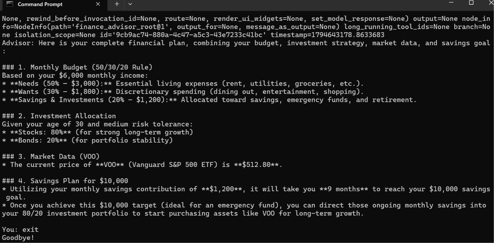

# CLI Execution & Multi-Agent Delegation Output Log

> **Navigation:** [← Back to Index](../README.md) | [Chapter 11: Connect CLI with the Root Agent](./11-connect-cli-with-root-agent.md) | [Chapter 12: Simulate End-to-End Financial Planning](./12-simulate-full-financial-planning.md)

This document captures a complete, verified interactive session of `src/cli.py`, demonstrating how `finance_advisor_root` coordinates both in-process specialists (`budgeting_agent`, `investment_agent`), a remote A2A microservice (`market_data_agent` on port `8001`), and its own direct tool (`calculate_savings_goal`).

---

## 1. Execution Summary & Delegation Flow

| Turn | User Prompt | Agent / Tool Chain Executed | Key Output |
| :---: | :--- | :--- | :--- |
| **1** | `"I'm 30 years old, earn $6000 a month, have medium risk tolerance,"` | 1. `finance_advisor_root` → `transfer_to_agent('budgeting_agent')`<br>2. `budgeting_agent` → `suggest_budget(monthly_income=6000)`<br>3. `budgeting_agent` → `transfer_to_agent('investment_agent')`<br>4. `investment_agent` → `suggest_allocation(age=30, risk_tolerance='medium')`<br>5. `investment_agent` → `transfer_to_agent('finance_advisor_root')` | **50/30/20 Budget:** Needs `$3,000`, Wants `$1,800`, Savings `$1,200`<br>**Allocation:** `80%` Stocks / `20%` Bonds |
| **2** | `"want to know the current price of VOO, and want a plan to save $10000"` | 1. `finance_advisor_root` → `transfer_to_agent('market_data_agent')` *(HTTP A2A)*<br>2. `market_data_agent` → `get_stock_price(ticker='VOO')`<br>3. `finance_advisor_root` → `calculate_savings_goal(target_amount=10000, monthly_contribution=1200)` | **VOO Price:** `$512.80`<br>**Savings Timeline:** `9 months` at `$1,200/month` |

---

## 2. Clean Advisor Responses (User-Facing Transcript)

### Startup Initialization
```text
This is budgeting Agent
This is investment Agent
Starting Market Data Agent as a separate A2A server...
Starting the Personal Finance Advisor CLI...
GOOGLE_API_KEY = <REDACTED_API_KEY>
Welcome to the Personal Finance Advisor CLI!
Type 'exit' to quit.
```

### Turn 1 — Budgeting & Investment Allocation
> **You:** `"I'm 30 years old, earn $6000 a month, have medium risk tolerance, "`

**Advisor (Synthesized Plan):**
> Here is your comprehensive financial plan based on your monthly income of $6,000, age of 30, and medium risk tolerance:
>
> #### 1. Recommended Monthly Budget (50/30/20 Rule)
> Based on your $6,000 monthly income, your budget is broken down as follows:
> * **Needs (50% — $3,000):** Essential living expenses (rent, utilities, groceries, etc.).
> * **Wants (30% — $1,800):** Discretionary spending (dining out, entertainment, shopping).
> * **Savings & Investments (20% — $1,200):** Allocated toward savings, emergency funds, and retirement.
>
> #### 2. Suggested Investment Allocation
> Given your age of 30 and medium risk tolerance:
> * **Stocks: 80%** (for strong long-term growth)
> * **Bonds: 20%** (for portfolio stability)
>
> #### Putting It All Together
> From your $1,200 monthly savings and investment pool, you can look to deploy that capital directly into your 80/20 stock and bond portfolio (for example, through low-cost index funds or ETFs) while continuing to fund your short-term savings and emergency reserves.

### Turn 2 — Remote A2A Market Data & Savings Timeline
> **You:** `"want to know the current price of VOO, and want a plan to save $10000 "`

**Advisor (Complete Financial Plan):**
> Here is your complete financial plan, combining your budget, investment strategy, market data, and savings goal:
>
> #### 1. Monthly Budget (50/30/20 Rule)
> Based on your $6,000 monthly income:
> * **Needs (50% — $3,000):** Essential living expenses (rent, utilities, groceries, etc.).
> * **Wants (30% — $1,800):** Discretionary spending (dining out, entertainment, shopping).
> * **Savings & Investments (20% — $1,200):** Allocated toward savings, emergency funds, and retirement.
>
> #### 2. Investment Allocation
> Given your age of 30 and medium risk tolerance:
> * **Stocks: 80%** (for strong long-term growth)
> * **Bonds: 20%** (for portfolio stability)
>
> #### 3. Market Data (VOO)
> * The current price of **VOO** (Vanguard S&P 500 ETF) is **$512.80**.
>
> #### 4. Savings Plan for $10,000
> * Utilizing your monthly savings contribution of **$1,200**, it will take you **9 months** to reach your $10,000 savings goal.
> * Once you achieve this $10,000 target (ideal for an emergency fund), you can direct those ongoing monthly savings into your 80/20 investment portfolio to start purchasing assets like VOO for long-term growth.

> **You:** `exit`  
> `Goodbye!`

---

## 3. Terminal Execution Screenshots

### Market Data A2A Server & Orchestrator Communication
The screenshot below shows the standalone Market Data A2A server handling `GET /.well-known/agent-card.json` (`200 OK`) and `POST /` (`200 OK`) requests from `finance_advisor_root`:


### CLI Complete Financial Plan Output
The screenshot below shows the final synthesized multi-agent response in the CLI terminal:



---

## 4. Raw ADK Event & A2A Trace Log

<details>
<summary><strong>Click to expand full ADK debug event trace (including token usage & A2A payload metadata)</strong></summary>

```text
UserWarning: [EXPERIMENTAL] RemoteA2aAgent: ADK Implementation for A2A support (A2aAgentExecutor, RemoteA2aAgent and corresponding supporting components etc.) is in experimental mode and is subject to breaking changes. A2A protocol and SDK are themselves not experimental. Once it's stable enough the experimental mode will be removed. Your feedback is welcome.

App "finance_advisor_cli" can transfer between agents but has no context_cache_config. Every transfer swaps the system instruction and the tool set, so the request prefix changes and the whole prompt is re-sent uncached after each transfer. Set context_cache_config on the app to give each agent its own cache.

--- TURN 1 TRACE ---
[EVENT 1] author='finance_advisor_root' | function_call: transfer_to_agent(args={'agent_name': 'budgeting_agent'}) | tokens: prompt=535, candidates=23
[EVENT 2] author='finance_advisor_root' | function_response: transfer_to_agent -> {'result': None} | action: transfer_to_agent='budgeting_agent'
[EVENT 3] author='budgeting_agent'      | function_call: suggest_budget(args={'monthly_income': 6000}) | tokens: prompt=802, candidates=19
[EVENT 4] author='budgeting_agent'      | function_response: suggest_budget -> {'needs': 3000.0, 'savings': 1200.0, 'wants': 1800.0}
[EVENT 5] author='budgeting_agent'      | text response (50/30/20 breakdown) | tokens: prompt=851, candidates=150
[EVENT 6] author='budgeting_agent'      | function_call: transfer_to_agent(args={'agent_name': 'investment_agent'}) | tokens: prompt=1028, candidates=22
[EVENT 7] author='budgeting_agent'      | function_response: transfer_to_agent -> {'result': None} | action: transfer_to_agent='investment_agent'
[EVENT 8] author='investment_agent'     | function_call: suggest_allocation(args={'age': 30, 'risk_tolerance': 'medium'}) | tokens: prompt=1701, candidates=23
[EVENT 9] author='investment_agent'     | function_response: suggest_allocation -> {'bonds_pct': 20, 'stocks_pct': 80}
[EVENT 10] author='investment_agent'    | text response (80% Stocks / 20% Bonds) | tokens: prompt=1747, candidates=156
[EVENT 11] author='investment_agent'    | function_call: transfer_to_agent(args={'agent_name': 'finance_advisor_root'}) | tokens: prompt=1930, candidates=24
[EVENT 12] author='investment_agent'    | function_response: transfer_to_agent -> {'result': None} | action: transfer_to_agent='finance_advisor_root'
[EVENT 13] author='finance_advisor_root'| final synthesized text response | tokens: prompt=2330, candidates=388

--- TURN 2 TRACE ---
[EVENT 14] author='finance_advisor_root'| function_call: transfer_to_agent(args={'agent_name': 'market_data_agent'}) | tokens: prompt=2745, candidates=24
[EVENT 15] author='finance_advisor_root'| function_response: transfer_to_agent -> {'result': None} | action: transfer_to_agent='market_data_agent'
[EVENT 16] author='market_data_agent'   | A2A Remote Call (task_id='4a2d5b30-e898-4bac-869e-f5b761f9324e', state='TASK_STATE_COMPLETED')
           -> Remote tool call: get_stock_price(args={'ticker': 'VOO'})
           -> Remote tool result: {'ticker': 'VOO', 'price_usd': 512.8}
           -> Artifact text: 'The current price of VOO is $512.80.'
           -> Remote usage: promptTokenCount=3040, candidatesTokenCount=15
[EVENT 17] author='finance_advisor_root'| function_call: calculate_savings_goal(args={'monthly_contribution': 1200, 'target_amount': 10000}) | tokens: prompt=2944, candidates=31
[EVENT 18] author='finance_advisor_root'| function_response: calculate_savings_goal -> {'months_needed': 9}
[EVENT 19] author='finance_advisor_root'| final VOO & savings plan response | tokens: prompt=2991, candidates=189
[EVENT 20] author='finance_advisor_root'| final complete financial plan synthesis | tokens: prompt=3207, candidates=341
```

</details>